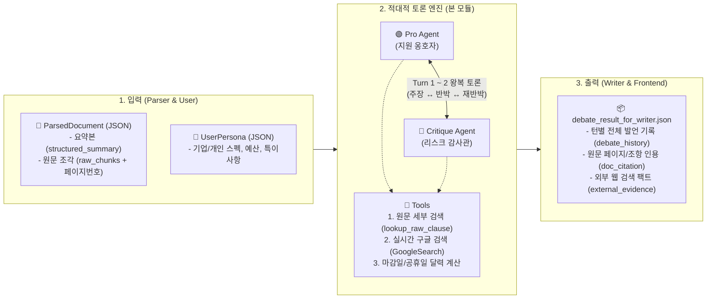

# agent-AI-Sogang
# ⚖️ 적대적 다중 에이전트 토론 모듈 (Pro & Critique Agents)

본 모듈은 **「적대적 다중 에이전트 토론 기반 공고·정책 문서 적격성 및 잠재 리스크 자동 검토 시스템」**의 핵심 추론 엔진입니다.  
단일 LLM의 확증 편향(Sycophancy)과 환각(Hallucination)을 방지하기 위해, **수주/지원 옹호자(`Pro Agent`)**와 **리스크 감사관(`Critique Agent`)**이 원문 검색 및 실시간 구글 검색 도구를 활용하여 최대 2~3턴간 치열하게 찬반 토론을 수행합니다.

---

## 1. 전체 파이프라인에서의 위치



---

## 2. 에이전트별 상세 역할 및 입출력 (I/O)

### 🟢 Pro Agent (수주/지원 옹호자)

* **핵심 역할**:
  * 지원자(기업/개인)가 해당 공고에 **왜 지원 가능한지(필수 자격 충족)**, **어떤 가점 요인이 있는지** 긍정적 근거를 최대한 발굴합니다.
  * 2턴부터는 `Critique Agent`가 지적한 결격 사유나 독소 조항에 맞서, 공고문 원문 내 **예외 조항(`"단, ~한 경우는 예외로 인정한다"`)**을 검색하여 방어 논리와 보완 대안(우회 전략, 대체 서류 제출 등)을 제시합니다.
* **사용 도구 (`tools.py`)**:
  * `lookup_raw_clause`: 2턴에서 원문 내 예외/단서/구제 조항(`단,`, `예외`, `인정`, `대체`, `완납` 등)을 정밀 검색합니다.
* **입력 (Input)**:
  1. `UserPersona`: 지원자 프로필 및 스펙
  2. `ParsedDocument`: 공고 메타데이터, 1차 요약본(`structured_summary`), 원문 예외 조항 검색 결과
  3. `debate_history`: 이전 턴의 토론 기록 (`Critique`의 공격 내용 포함)
* **출력 (`ProOutput` - `schemas.py`)**:
  ```json
  {
    "turn": 2,
    "overall_stance": "특허 출원 및 체납 이력에 대한 예외 규정 충족으로 지원 적격하며 가점 3점 확보 가능",
    "claims": [
      {
        "category": "필수자격",
        "assertion": "서울 본사 소재 및 창업 2.5년차 중소기업으로 기본 자격 요건 완벽 부합",
        "user_evidence": "서울 마포구 본사, 업력 2.5년",
        "doc_citation": "p.2 제2조 1항"
      }
    ],
    "rebuttal_to_critic": [
      "지방세 체납 지적 건은 2026년 9월 전액 완납증명서를 보유하고 있어 제5조 1항 단서 조항에 따라 적격 인정됨 (p.5 제5조 1항)",
      "특허 출원 건은 IITP 공인 기술성 평가 80점 이상 확인서로 대체 제출 가능 (p.2 제2조 2항)"
    ]
  }
  ```

---

### 🔴 Critique Agent (악마의 대변인 / 리스크 감사관)

* **핵심 역할**:
  * `Pro Agent`의 장밋빛 주장을 정면으로 의심하고 반박합니다.
  * `Parser`의 1차 요약본에 생략된 **구석진 독소 조항(별표, 각주, 현금 비중, 의무 조건 등)**과 **외부 실시간 변수(마감일 주말/공휴일 여부, 기관 감사 기준 등)**를 찾아내어 치명적 탈락 위험을 팩트 기반으로 경고합니다.
  * **신뢰성 강제 룰**: 뇌피셜 반박을 금지하며, 모든 지적 사항에 **반드시 공고문 원문 페이지 번호와 조항 번호(`doc_citation`)를 인용**합니다.
* **사용 도구 (`tools.py`)**:
  * `lookup_raw_clause`: 원문 청크(`raw_chunks`)에서 독소 조항 키워드(`별표`, `주의`, `제외`, `실격`, `미달`, `현금`, `출원` 등)를 정밀 수색합니다.
  * `web_search_with_gemini`: Gemini 내장 **실시간 Google Search Grounding**을 호출하여 공고 취소/연장 공지, 최근 심사 탈락 사례를 검색하고 출처 URL을 추출합니다.
  * `get_calendar_fact`: 접수 마감일이 주말/공휴일인지 계산하여 전산 마감 및 헬프데스크 휴무 리스크를 검출합니다.
* **입력 (Input)**:
  1. `UserPersona`: 지원자 프로필 및 스펙
  2. `ParsedDocument` + `Tool 1(원문 독소조항 검색 결과)` + `Tool 2(실시간 구글 검색 및 달력 팩트)`
  3. `ProOutput`: 방금 `Pro Agent`가 발표한 주장 및 재반박 논리
  4. `debate_history`: 이전 턴까지의 토론 기록
* **출력 (`CritiqueOutput` - `schemas.py`)**:
  ```json
  {
    "turn": 2,
    "is_fatal": true,
    "risks": [
      {
        "severity": "CRITICAL",
        "target_pro_claim": "자부담 가용 예산 2,500만원 보유로 민간부담금(20%) 충족 주장",
        "counter_argument": "총액(2,500만원)은 충족하나 현금이 1,000만원뿐임. 별표1 규정에 따라 민간부담금 중 현금 비중 50%(최소 1,250만원) 미달 시 서류 심사에서 즉시 자동 실격 처리됨.",
        "doc_citation": "p.3 제3조 별표1",
        "external_evidence": "최근 서울경제진흥원(SBA) 감사 기준 강화로 현금 비율 미달 기업 서류 자동 탈락 다수 발생"
      },
      {
        "severity": "WARNING",
        "target_pro_claim": "마감일(2026-10-25 18:00) 내 정상 접수 가능",
        "counter_argument": "마감일인 10월 25일은 일요일(주말)로 전산 오류 고객센터가 운영되지 않으므로 금요일(10월 23일) 17시 이전 제출 필수.",
        "doc_citation": "p.9 제10조",
        "external_evidence": "[달력 팩트체크] 마감일(2026-10-25)은 '일요일'입니다."
      }
    ]
  }
  ```

---

## 3. Pro ↔ Critique 상호작용 (2턴 왕복 토론 프로토콜)

상태 머신(`debate_runner.py`)이 아래 순서로 **최대 2회 왕복(총 4회 발언)**을 제어하여 무한 루프와 토큰 낭비를 방지합니다.

| 단계 | 발화자 | 주요 행동 및 상호작용 |
| :---: | :---: | :--- |
| **Turn 1-A** | 🟢 **Pro** | `structured_summary`(1차 요약본)와 사용자 스펙을 대조하여 **초기 긍정 주장 및 가점 사항** 발표 |
| **Turn 1-B** | 🔴 **Critique** | `원문 정밀 검색` + `실시간 구글 검색` 실행 → 요약본에 안 나온 **숨은 독소조항(특허 출원 불인정, 현금 50% 규정, 주말 마감 등)**을 근거로 Pro의 1차 주장을 강력 반박 |
| **Turn 2-A** | 🟢 **Pro** | Critique의 지적 사항을 확인한 뒤, 원문에서 **`"단, ~한 경우는 예외로 한다"` 조항을 재검색** → 방어 가능한 항목(완납증명서, 기술성 평가 대체 등)에 대해 **재반박 및 해결책(`rebuttal_to_critic`)** 제시 |
| **Turn 2-B** | 🔴 **Critique** | Pro의 소명 중 타당한 것은 수용하고, **여전히 해결되지 않은 치명적 결격 사유(`CRITICAL`, 예: 현금 250만원 부족)와 필수 주의사항(`WARNING`)**을 최종 확정하여 Writer에게 전달 |

---

## 4. 다른 파트(Parser, Writer, 프론트엔드)와의 연동 가이드

### ① Parser 담당자 → 본 모듈에 넘겨줄 데이터
* `schemas.py`의 `ParsedDocument` 구조(`mock_data.json` 참고)에 맞춰 JSON을 생성해 주세요.
* **필수 사항**: `Critique`이 원문 페이지 번호를 인용해야 하므로 `raw_chunks` 리스트 안에 반드시 `page`(정수)와 `section`(조항 제목), `text`(원문)가 포함되어야 합니다.

### ② 본 모듈 → Writer & 프론트엔드 담당자에게 넘겨주는 데이터
* `debate_runner.py`의 `run_adversarial_debate()`를 실행하면 **`debate_result_for_writer.json`** 파일이 생성됩니다.
* **Writer 담당자**: 이 JSON 파일의 `debate_history`를 읽어서 최종 적격성 판정 및 리스크 진단 보고서를 작성하면 됩니다.
* **프론트엔드(Streamlit) 담당자**: `debate_history` 리스트를 순서대로 순회하며 `agent == "Pro"`와 `agent == "Critique"`의 발언(`claims`, `rebuttal_to_critic`, `risks`)을 실시간 토론 UI로 렌더링하면 됩니다.

---

## 5. 폴더 구조 및 실행 방법

```text
📦 프로젝트
 ┣ 📜 schemas.py                   # 입출력 데이터 스키마 (Pydantic)
 ┣ 📜 tools.py                     # 원문 검색, 달력 계산, Gemini 실시간 구글 검색 도구
 ┣ 📜 agents.py                    # Pro & Critique 에이전트 클래스 구현
 ┣ 📜 debate_runner.py             # 상태 머신(2턴 왕복) 제어 및 실행 엔트리포인트
 ┣ 📜 mock_data.json               # 테스트용 가상 공고문 및 지원자 페르소나 데이터
 ┣ 📜 debate_result_for_writer.json # (실행 시 생성) Writer 및 프론트엔드 전달용 결과 파일
 ┣ 📜 requirements.txt             # 필수 라이브러리 목록
 ┗ 📜 .env                         # GEMINI_API_KEY 설정 파일 (.gitignore 처리됨)
```

### 실행 명령어
```bash
pip install -r requirements.txt
python3 debate_runner.py
```
